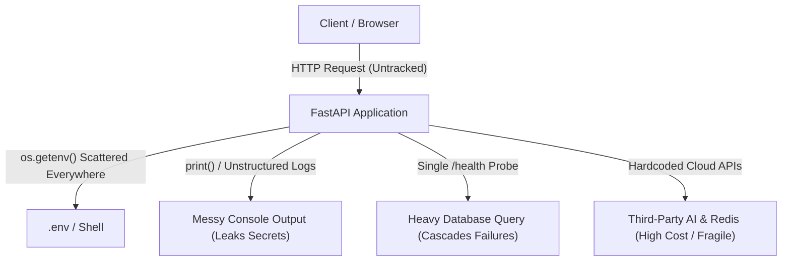
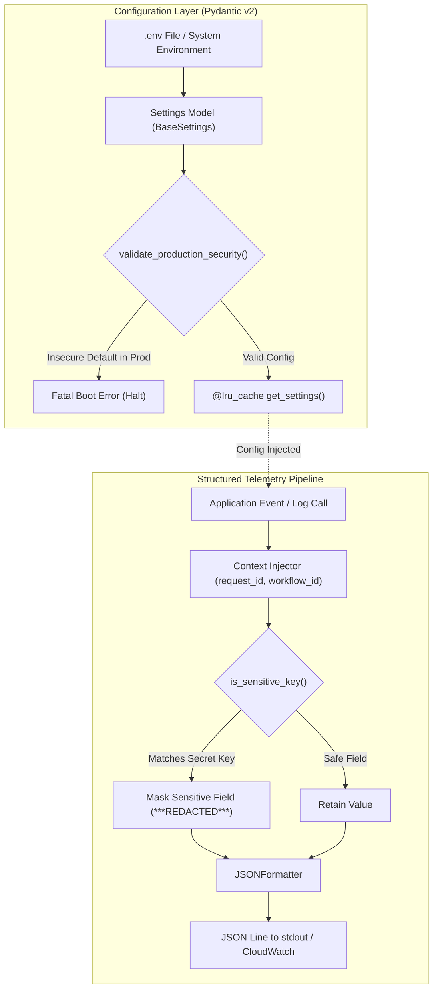
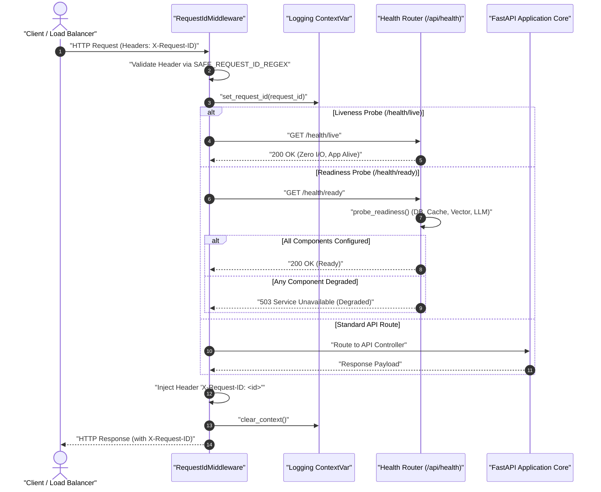
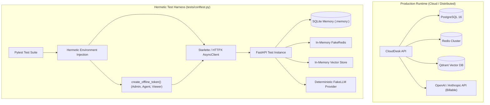
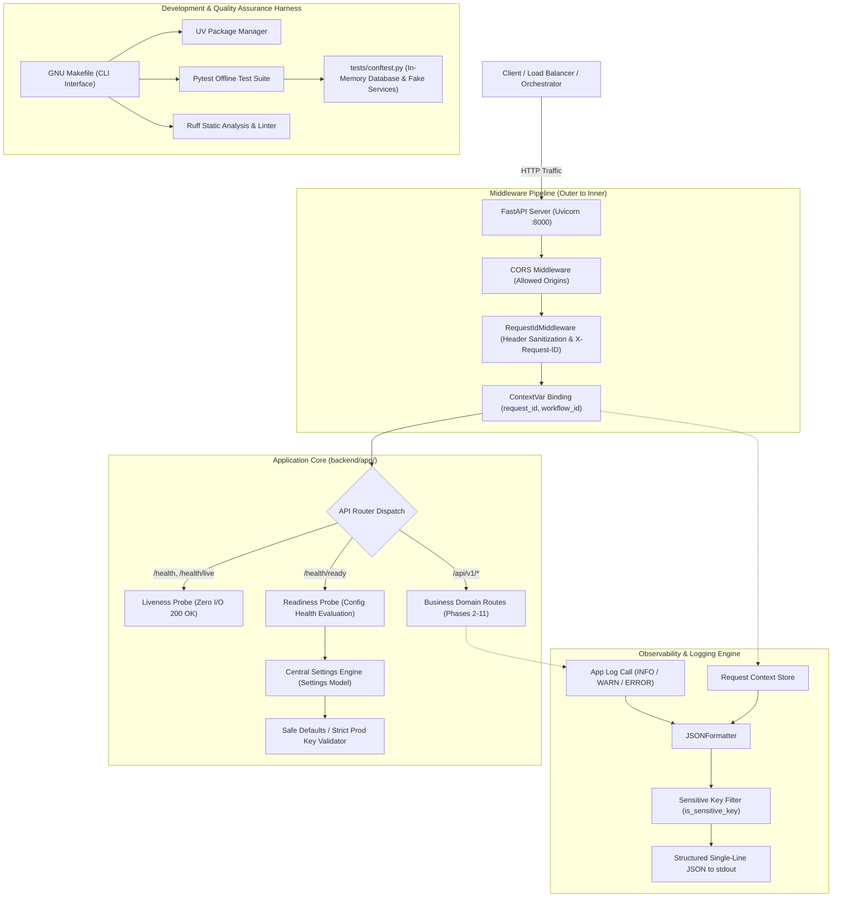

# Phase 1: Project System Design Evolution — The Runtime Skeleton

This document chronicles the step-by-step architectural evolution of **Phase 1 (Runtime Skeleton)** for the CloudDesk platform. It illustrates how the system design transitioned from an initial primitive concept into an enterprise-grade, observable, and hermetic runtime foundation.

---

## 1. Architectural Mission of Phase 1

Before constructing multi-agent AI pipelines, semantic vector search, or database schemas, an enterprise SaaS system requires a foundational runtime skeleton. The primary architectural goals of Phase 1 were:

1. **Centralized Configuration & Safe Defaults:** Eliminating scattered environment lookups and enforcing strict security boundaries on startup.
2. **High-Fidelity Observability & Privacy:** Emitting machine-readable structured JSON telemetry while mathematically preventing sensitive credential exposure.
3. **Decoupled System Health Probing:** Supporting cloud-native container orchestration (e.g., Kubernetes, AWS ECS) with segregated liveness and readiness probes.
4. **Hermetic Testability:** Ensuring the entire application can be tested offline without external cloud dependencies or billable API invocations.

---

## 2. Evolution Stage 0: The Naive Architecture (The Problem Space)

At the inception of the project, a conventional or naive web implementation would suffer from fragmented configuration, unstructured logging, and untraceable HTTP requests.

### Critical Flaws in the Initial State:
* **Scattered Configuration:** Components directly read `os.getenv()`. Inconsistent defaults or typos caused runtime crashes deep in call stacks.
* **Sensitive Data Leaks:** Standard text logging risked printing API keys, passwords, and credit card numbers directly into log aggregators.
* **Single Health Endpoint Failure:** A single `/health` endpoint that pinged databases created cascading failures; if the database experienced high latency, the container orchestrator killed healthy backend workers.
* **Flaky & Expensive Tests:** Automated tests required active internet connections, live database instances, and paid API credentials.

---

## 3. Evolution Stage 1: P1-1 · Centralized Configuration & Structured JSON Telemetry

The first evolutionary leap introduced strongly typed configuration modeling and a structured logging pipeline with automatic context tracking.

### Architecture Components Introduced:
* [`Settings`](file:///Users/lokeshrepaka/Desktop/CLOUDDESK/backend/app/core/config.py#L9-L102): Pydantic v2 `BaseSettings` object reading from `.env` with cached retrieval via [`get_settings()`](file:///Users/lokeshrepaka/Desktop/CLOUDDESK/backend/app/core/config.py#L103-L106).
* [`validate_production_security`](file:///Users/lokeshrepaka/Desktop/CLOUDDESK/backend/app/core/config.py#L78-L90): Boot-time security barrier preventing staging/production from booting with default development keys.
* [`JSONFormatter`](file:///Users/lokeshrepaka/Desktop/CLOUDDESK/backend/app/core/logging.py#L83-L115): Formatter translating log records into single-line JSON lines containing UTC timestamps, logger namespaces, and levels.
* [`is_sensitive_key`](file:///Users/lokeshrepaka/Desktop/CLOUDDESK/backend/app/core/logging.py#L51-L55): Telemetry filter pattern matcher masking passwords, tokens, API keys, and credit cards.
* `contextvars` ([`request_id_ctx`](file:///Users/lokeshrepaka/Desktop/CLOUDDESK/backend/app/core/logging.py#L9), [`workflow_id_ctx`](file:///Users/lokeshrepaka/Desktop/CLOUDDESK/backend/app/core/logging.py#L10)): Asynchronous thread-safe context binding.

---

## 4. Evolution Stage 2: P1-2 · Traffic Interception, Request Tracing & Dual Health Probes

In the second milestone, we integrated edge middleware into the HTTP lifecycle and decoupled system health diagnostics into distinct liveness and readiness contracts.

### Architecture Components Introduced:
* [`RequestIdMiddleware`](file:///Users/lokeshrepaka/Desktop/CLOUDDESK/backend/app/middleware/request_id.py#L14-L32): Intercepts all incoming HTTP calls. Extracts incoming `X-Request-ID` or generates a UUIDv4.
* `SAFE_REQUEST_ID_REGEX`: Strips CRLF and validates alphanumeric/hyphen patterns up to 128 characters to thwart HTTP response splitting and header injection.
* Dual Health Probes ([`backend/app/api/health.py`](file:///Users/lokeshrepaka/Desktop/CLOUDDESK/backend/app/api/health.py)):
  * [`/health/live`](file:///Users/lokeshrepaka/Desktop/CLOUDDESK/backend/app/api/health.py#L57-L61): Zero I/O liveness check returning HTTP 200 immediately.
  * [`/health/ready`](file:///Users/lokeshrepaka/Desktop/CLOUDDESK/backend/app/api/health.py#L63-L69): Probes configuration readiness across Database, Redis, Vector Store, and LLM. Returns HTTP 200 when ready or HTTP 503 `degraded` if unconfigured.
  * [`/health`](file:///Users/lokeshrepaka/Desktop/CLOUDDESK/backend/app/api/health.py#L46-L55): General metadata endpoint returning version and environment name.

---

## 5. Evolution Stage 3: P1-3 · Fully Hermetic Offline Test Harness

The third milestone engineered the test framework, isolating local development and CI pipelines from external network and billing dependencies.

### Architecture Components Introduced:
* [`tests/conftest.py`](file:///Users/lokeshrepaka/Desktop/CLOUDDESK/tests/conftest.py): Global test harness automatically executed by `pytest`.
* **Zero-Network Environment Isolation:** Pre-populates environment variables before application import:
  * `DATABASE_URL = sqlite+aiosqlite:///:memory:` (instant ephemeral memory database).
  * `CHECKPOINT_DB_PATH = :memory:` (in-memory LangGraph checkpointer).
  * `USE_FAKE_REDIS = true` & `REDIS_URL = ""` (fakeredis in-memory mock).
  * `VECTOR_STORE = memory` (in-memory cosine similarity vector index).
  * `LLM_PROVIDER = fake` (deterministic mock LLM provider).
* [`create_offline_token()`](file:///Users/lokeshrepaka/Desktop/CLOUDDESK/tests/conftest.py#L31-L42): Synthetic JWT generation with HS256 and 8-hour expiry for role fixtures (`admin_token`, `agent_token`, `viewer_token`).

---

## 6. Evolution Stage 4: P1-4 · Developer Automation, Environment Blueprints & Final Phase 1 Topology

The final milestone unified developer operations into a single CLI toolchain and produced an environment configuration blueprint.

### Architecture Components Introduced:
* [`Makefile`](file:///Users/lokeshrepaka/Desktop/CLOUDDESK/Makefile): Command orchestration layer implementing standard lifecycle verbs:
  * `make setup`: Dependency installation (`uv sync`) and `.env` initialization from `.env.example`.
  * `make test`: Executes offline hermetic test suite with `uv run pytest -v`.
  * `make lint`: Enforces code standards and security checks via `uv run ruff`.
  * `make backend`: Starts Uvicorn development server with hot reloading.
* [`.env.example`](file:///Users/lokeshrepaka/Desktop/CLOUDDESK/.env.example): Fully documented, production-aligned environment variable catalog with safe default configurations.
* Application Factory [`create_application()`](file:///Users/lokeshrepaka/Desktop/CLOUDDESK/backend/app/main.py#L33-L79): Assembles CORS middleware, audit middleware, request ID middleware, health endpoints, and database/Redis disposal lifecycles.

---

## 7. Cumulative Phase 1 System Architecture

By the conclusion of Phase 1, all components formed an integrated runtime foundation:

---

## 8. Architectural Trade-offs & Design Decisions

| Decision | Selected Approach | Alternative Considered | Architectural Rationale |
|---|---|---|---|
| **Configuration Loading** | Pydantic v2 `BaseSettings` with `@lru_cache` | Raw `os.environ` or dynamic YAML files | Provides compile-time validation, automatic type coercion, and prevents expensive disk I/O per request while catching missing credentials on boot. |
| **Telemetry Format** | Single-line JSON with ISO-8601 timestamps | Unstructured plain-text console logging | Plain text cannot be reliably indexed or queried by modern log aggregators (Datadog, CloudWatch, Loki) and lacks context variables for asynchronous tracing. |
| **Request ID Security** | Regex-validated header or generated UUID | Trusting raw client `X-Request-ID` directly | Untrusted headers can carry Carriage Return Line Feed (`\r\n`) payloads, exposing log parsers and proxies to HTTP response splitting attacks. |
| **Health Probes** | Decoupled `/health/live` (zero I/O) and `/health/ready` (config probe) | Single unified `/health` endpoint with active DB ping | Prevents temporary database hiccups or network blips from triggering Kubernetes cascade pod terminations. |
| **Test Environment** | 100% Hermetic in-memory mock harness | Requiring local Dockerized Postgres & Redis for unit tests | Eliminates developer friction, enables instant test execution in CI/CD pipelines, and prevents billable third-party AI API calls during local testing. |

